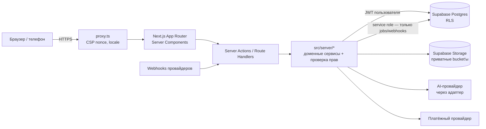

# Архитектура Okuspace Next

Статус: **утверждено пользователем 2026-10-15** (этап 1). Связанные документы:

- [DATA_MODEL.md](DATA_MODEL.md) — модель данных
- [AUTH_FLOWS.md](AUTH_FLOWS.md) — авторизация
- [CONVENTIONS.md](CONVENTIONS.md) — именование и миграции
- [TESTING_STRATEGY.md](TESTING_STRATEGY.md) — тестирование
- [../operations/ENVIRONMENTS.md](../operations/ENVIRONMENTS.md) — окружения и деплой
- [../security/SECURITY_BASELINE.md](../security/SECURITY_BASELINE.md) — критерии безопасности
- [../DECISIONS.md](../DECISIONS.md) — журнал решений

## 1. Контекст

Платформа языковой школы:

- от 100 до 1000 учеников, несколько филиалов в разных городах;
- очные и онлайн-занятия;
- интерфейс на KG/RU/EN;
- 9 ролей;
- в будущем — несколько организаций (multi-tenant).

## 2. Обзор системы



## 3. Границы доверия

| Зона | Доверие | Правило |
|---|---|---|
| Браузер, клиентские компоненты | **Не доверяем** | Скрытие кнопок — только удобство. Любой ввод проверяется сервером через Zod |
| Server Components / Server Actions / Route Handlers | Доверенный код, недоверенный ввод | Каждая защищённая операция: (1) сессия из `supabase.auth.getUser()`, а не из cookie напрямую; (2) проверка права в `src/server/authz`; (3) Zod-валидация |
| Postgres + RLS | Последняя линия обороны | RLS включён на **всех** таблицах с данными. Обычные запросы идут с JWT пользователя, поэтому ошибка в коде приложения не открывает чужие данные |
| Service role key | Максимальные права | Только в `src/server/**` с `import 'server-only'`. Только для фоновых задач, webhook'ов и администрирования платформы. Каждое использование журналируется |
| Внешние сервисы (AI, оплата, email, камеры) | Не доверяем ответам | Тайм-ауты, проверка подписей webhook, идемпотентность, лимиты |

## 4. Структура каталогов

```text
src/
  app/                    маршруты (App Router). Только композиция UI и вызовы server/*
    [locale]/             локализованные страницы (ky | ru | en)
    api/                  Route Handlers: health, webhooks
  components/             переиспользуемые UI-компоненты без бизнес-логики
    ui/                   примитивы дизайн-системы (этап 4)
  features/<module>/      UI и клиентская логика модуля (формы, таблицы)
  server/                 ТОЛЬКО сервер ('server-only'): доступ к БД, бизнес-правила
    supabase/             фабрики клиентов (user-scoped, service-role)
    authz/                проверка прав (этап 3)
    <module>/             сервисы модулей: queries.ts, actions.ts, schemas.ts
  lib/                    чистые утилиты без побочных эффектов: env, errors, logger, i18n
  hooks/                  React-хуки
  types/                  общие типы, сгенерированные типы БД (database.ts)
  i18n/dictionaries/      словари ky/ru/en
supabase/
  migrations/             SQL-миграции (этап 2)
  seed.sql                только для dev/test (никогда не для production)
tests/
  unit/  integration/  e2e/  security/
docs/
  architecture/ audit/ operations/ security/
scripts/                  проверочные скрипты (секреты в сборке и т. п.)
```

## 5. Модули и их границы

| Модуль | Ответственность | Этап |
|---|---|---|
| `tenancy` | Организации, филиалы, настройки | 2 |
| `identity` | Профили, членства, роли, приглашения, MFA, блокировка | 2–3 |
| `catalog` | Языки, уровни (CEFR), курсы, тарифы | 5 |
| `learning` | Модули, уроки, материалы, задания, тесты, попытки, прогресс | 5 |
| `scheduling` | Группы, записи на курс, аудитории, занятия, переносы | 6 |
| `attendance` | События посещаемости (сырые) → подтверждённые отметки | 6 |
| `ai-lab` | Адаптер AI-провайдера, лимиты, учёт расхода | 7 |
| `crm` | Заявки, контакты, этапы, пробные уроки | 8 |
| `finance` | Счета, платежи, распределения, корректировки, отчёты | 9 |
| `monitoring` | Камеры, занятость, очередь проверки | 10 |
| `notifications` | Шаблоны, очередь, каналы, предпочтения | 11 |
| `analytics` | Агрегаты и панели | 12 |
| `audit` | Неизменяемый журнал важных действий | 2 (сквозной) |

**Правила зависимостей:**

- `app` → `features` → `components`/`lib`.
- `app`/`features` → `server` только через Server Actions или серверные функции.
- Модули внутри `server` обращаются друг к другу через публичные функции модуля (`index.ts`), а не через чужие таблицы напрямую. Исключение — SQL-представления для аналитики.

## 6. Серверные и клиентские компоненты

- По умолчанию всё — **Server Components**. `"use client"` ставится только там, где нужны состояние, события или браузерные API.
- Данные загружаются на сервере через `server/<module>/queries.ts`. Мутации идут через Server Actions из `server/<module>/actions.ts`.
- Каждый action выполняется в 4 шага: `parse(input)` (Zod) → `requireSession()` → `authorize(permission, scope)` → выполнение → `audit()` для важных действий → результат `Result<T>`.
- Клиент получает только DTO без служебных полей. Секретов и сырых ошибок БД в DTO нет.

## 7. Обработка ошибок

- `src/lib/errors.ts`: `AppError` с кодом из закрытого списка (`VALIDATION`, `UNAUTHENTICATED`, `FORBIDDEN`, `NOT_FOUND`, `CONFLICT`, `RATE_LIMITED`, `UNAVAILABLE`, `INTERNAL`).
- Наружу уходит только `{ code, message, fieldErrors? }`. Stack trace и SQL никогда не уходят на клиент.
- Неожиданные исключения логируются с `requestId`, пользователь видит общее сообщение и `requestId` для поддержки.
- В UI каждой операции соответствует понятное состояние: успех, ошибка валидации, отказ в доступе, временная недоступность.

## 8. Логирование

- `src/lib/logger.ts`: структурированный JSON (`level`, `msg`, `time`, `requestId`, контекст).
- **Редакция секретов** встроена: ключи `password`, `token`, `secret`, `authorization`, `cookie`, `apiKey`, `service_role` и т. п. заменяются на `[REDACTED]` на любой глубине вложенности. Это покрыто unit-тестом.
- Журнал аудита (`audit_logs` в БД) отделён от технических логов. Технические логи можно ротировать, аудит — append-only.

## 9. Конфигурация

- `src/lib/env.ts`: Zod-схемы. **Публичные** переменные (`NEXT_PUBLIC_*`) и **серверные** живут в разных модулях. Серверный модуль импортирует `server-only`, поэтому попытка подключить его в клиентский компонент ломает сборку.
- При неверной конфигурации приложение падает на старте с понятным сообщением без значений секретов.
- Секреты хранятся только в env хостинга и Supabase. В репозитории лежит только `.env.example` без значений.

## 10. Интернационализация

- Локали: `ky` (кыргызский), `ru`, `en`. Используются ISO 639-1 коды: `ky`, а не `kg`. Локаль по умолчанию — `ru` (утверждено, ADR-0003).
- Локаль хранится в URL (`/ky/...`). Переключение языка сохраняет путь и параметры запроса.
- Словари — типизированные TS-объекты. Форма словаря `ru` — эталон, и пропущенный ключ в `ky`/`en` даёт ошибку компиляции.
- Даты и деньги форматируются через `Intl`, время отображается в часовом поясе филиала.

## 11. Безопасность по умолчанию

Подробно — в [SECURITY_BASELINE.md](../security/SECURITY_BASELINE.md). В каркасе этапа 1 уже работают:

- CSP с nonce, сгенерированным в `proxy.ts`;
- заголовки HSTS, X-Content-Type-Options, Referrer-Policy, Permissions-Policy и frame-ancestors;
- `poweredByHeader: false`;
- проверка клиентской сборки на секреты.

## 12. Что сознательно НЕ делается на этапе 1

Таблицы, RLS, авторизация, бизнес-модули и дизайн-система. Это этапы 2–5.
