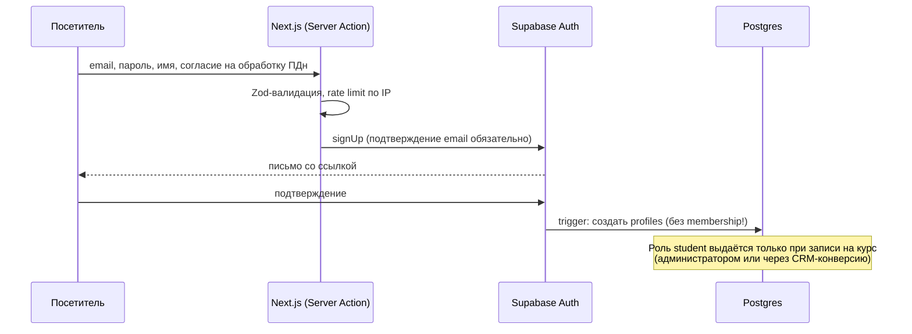
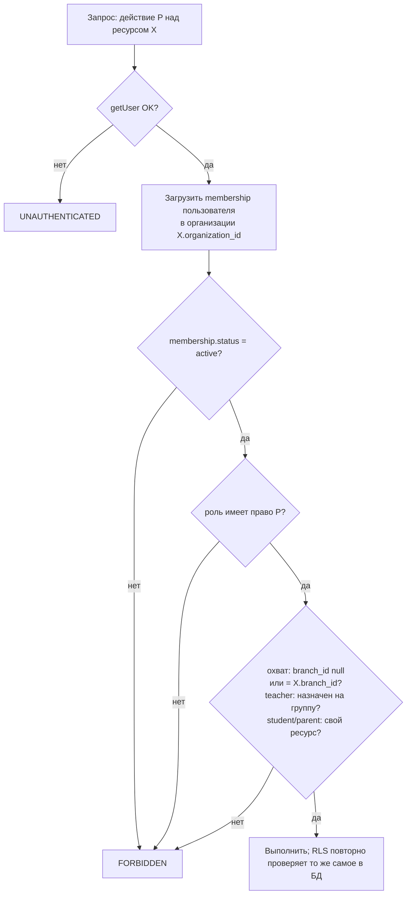

# Потоки аутентификации и авторизации

Статус: **предложение этапа 1**. Реализация запланирована на этапы 2–3.

## 1. Сессия

- Используется Supabase Auth: email + пароль, magic link как опция. Сессия хранится в HttpOnly cookie через `@supabase/ssr`.
- На сервере пользователь определяется **только** через `supabase.auth.getUser()`, который проверяет JWT на сервере Auth. `getSession()` для решений о доступе не используется: он не проверяет подпись.
- `proxy.ts` обновляет истёкший access token. Решения о доступе принимаются не там, а в серверном коде страницы или действия и в RLS.

## 2. Регистрация ученика (публичная)

Самостоятельная регистрация **никогда** не выдаёт роль сотрудника. Роли сотрудников выдаются только через приглашения и членства (см. §3).

## 3. Приглашение сотрудника

1. Пользователь с правом `identity.invite` в нужном охвате создаёт `invitations`: email, роль, филиал. Токен генерируется криптостойко, в БД хранится **только его хеш**. Срок действия — 72 часа.
2. Письмо со ссылкой `/{locale}/invite/{token}`.
3. При принятии приглашения сервер проверяет хеш токена, срок действия и совпадение email с аутентифицированным пользователем. Затем в одной транзакции создаёт membership и помечает приглашение использованным. Повторное использование невозможно.
4. Событие записывается в `audit_logs`.

## 4. Восстановление пароля

- Используется `resetPasswordForEmail`. Ответ одинаковый независимо от того, существует ли email, — это защита от перебора аккаунтов.
- Есть rate limit на email и на IP. Ссылка одноразовая и с коротким сроком действия (настройки Supabase).
- После смены пароля все остальные сессии завершаются (`signOut({ scope: 'others' })`), пользователь получает уведомление.

## 5. MFA

- TOTP (Supabase MFA) **обязателен** для ролей `platform_owner`, `org_director`, `branch_manager`, `accountant`, `admin`.
- Защищённые разделы этих ролей требуют `aal2`. RLS-политики финансовых таблиц дополнительно проверяют `auth.jwt()->>'aal' = 'aal2'`.

## 6. Авторизация (RBAC + охват)

- Права хранятся в БД (`role_permissions`) и проверяются **дважды**: в `src/server/authz` (понятная ошибка для UI) и в RLS через функцию `has_permission(org, branch, perm)` с `SECURITY DEFINER STABLE` и фиксированным `search_path`.
- Роль **не** кэшируется в cookie или JWT без проверки. Блокировка membership действует со следующего запроса, а не после истечения сессии.- Попытка доступа к чужому ресурсу возвращает `NOT_FOUND`, а не `FORBIDDEN`, если сам факт существования ресурса — чувствительная информация.

## 7. Блокировка и восстановление доступа

- Блокировка: `memberships.status = 'blocked'` + завершение сессий через Admin API (service role, только на сервере, с записью в журнал аудита).
- Полная блокировка аккаунта: `auth.admin.updateUserById(..., { ban_duration })`.
- Восстановление — обратная операция с указанием причины. Все действия пишутся в `audit_logs`.

## 8. Rate limiting

- Вход, регистрация, сброс пароля, приглашения, AI: лимиты по IP и по аккаунту хранятся на сервере (таблица Postgres или Upstash/Redis — решение на этапе 3). В сессии лимиты не хранятся.
