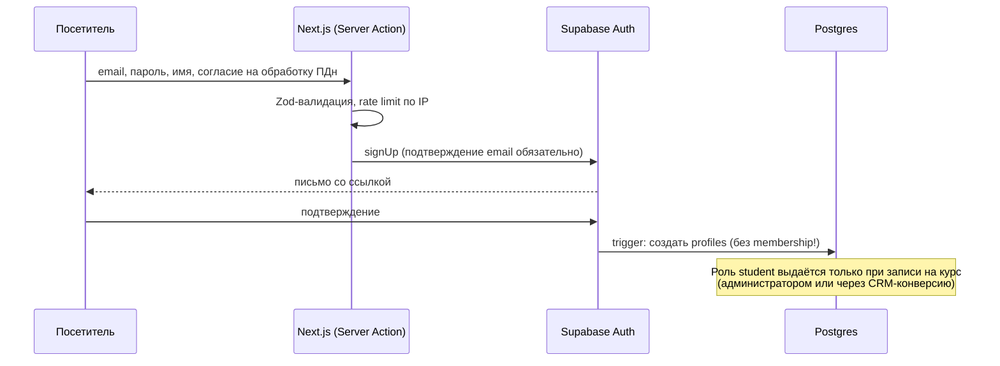
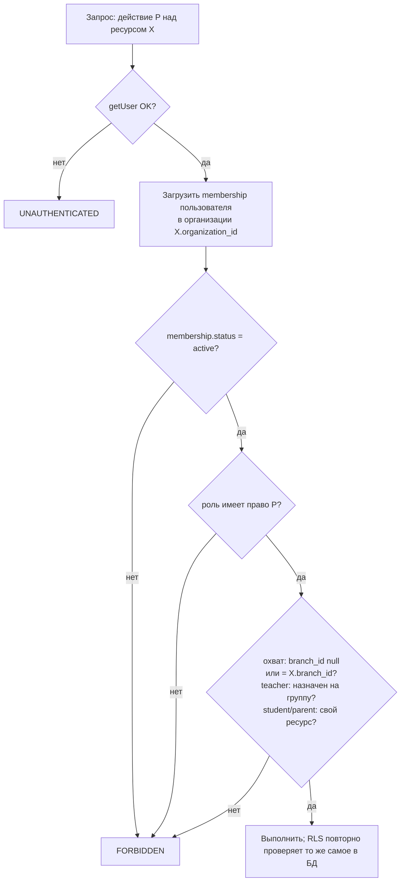

# Потоки аутентификации и авторизации

Статус: **реализовано на этапах 2–3** (проверено локально; на настоящем Supabase — см. [SUPABASE_AUTH.md](../operations/SUPABASE_AUTH.md) §7).

## 1. Сессия

- Используется Supabase Auth: email + пароль, magic link как опция. Сессия хранится в HttpOnly cookie через `@supabase/ssr`.
- На сервере пользователь определяется **только** через `supabase.auth.getUser()`, который проверяет JWT на сервере Auth. `getSession()` для решений о доступе не используется: он не проверяет подпись.
- `proxy.ts` обновляет истёкший access token. Решения о доступе принимаются не там, а в серверном коде страницы или действия и в RLS.

## 2. Регистрация ученика (публичная)

Самостоятельная регистрация **никогда** не выдаёт роль сотрудника. Роли сотрудников выдаются только через приглашения и членства (см. §3).

## 3. Приглашение сотрудника

1. Пользователь с правом `identity.invite` в нужном охвате создаёт `invitations`: email, роль, филиал. Токен генерируется криптостойко, в БД хранится **только его хеш**. Срок действия — 72 часа.
2. Ссылка `/{locale}/invite/{token}` **показывается пригласившему один раз**; он передаёт её приглашённому. Отправка писем появится на этапе 11. Токен — 32 случайных байта (base64url).
3. Принятие — RPC `public.accept_invitation(token)`. Она в одной транзакции проверяет хеш, срок, отзыв, совпадение email из JWT и то, что **пригласивший всё ещё вправе выдать эту роль**; затем создаёт membership и помечает приглашение использованным. Для всех причин отказа ошибка одна и та же. Директора приглашает только владелец платформы.
4. Событие записывается в `audit_logs`.

## 4. Восстановление пароля

- Используется `resetPasswordForEmail`. Ответ одинаковый независимо от того, существует ли email, — это защита от перебора аккаунтов.
- Есть rate limit на email и на IP. Ссылка одноразовая и с коротким сроком действия (настройки Supabase).
- После смены пароля все остальные сессии завершаются (`signOut({ scope: 'others' })`), пользователь получает уведомление.

## 5. MFA

- TOTP (Supabase MFA) **обязателен** для владельца платформы и всех ролей с правами `member.manage`, `finance.write` или `finance.refund`: `org_director`, `branch_manager`, `admin`, `sales_manager`, `accountant` (`requiresMfa` в `src/server/authz/check.ts`).
- Кабинет этих ролей требует `aal2` (`requireAccess` → `/mfa`). БД дополнительно требует `aal2` для выдачи и изменения ролей, приглашений, опекунства, создания организаций и записи финансов (миграции 0005–0006).

## 6. Авторизация (RBAC + охват)

- Права хранятся в БД (`role_permissions`) и проверяются **дважды**: в `src/server/authz` (понятная ошибка для UI) и в RLS через функцию `has_permission(org, branch, perm)` с `SECURITY DEFINER STABLE` и фиксированным `search_path`.
- Роль **не** кэшируется в cookie или JWT без проверки. Блокировка membership действует со следующего запроса, а не после истечения сессии.- Попытка доступа к чужому ресурсу возвращает `NOT_FOUND`, а не `FORBIDDEN`, если сам факт существования ресурса — чувствительная информация.

## 7. Блокировка и восстановление доступа

- Блокировка: `memberships.status = 'blocked'` + завершение сессий через Admin API (service role, только на сервере, с записью в журнал аудита).
- Полная блокировка аккаунта: `auth.admin.updateUserById(..., { ban_duration })`.
- Восстановление — обратная операция с указанием причины. Все действия пишутся в `audit_logs`.

## 8. Rate limiting

- Таблица `rate_limits` + `hit_rate_limit()` (только service role). Ключи — SHA-256 от идентификатора, без ПДн. Если хранилище лимитов недоступно, запрос отклоняется (fail closed).
- Лимиты (`LIMITS` в `src/server/auth/use-cases.ts`):
  - вход: 30 запросов с одного IP и 5 попыток на один email за 15 минут;
  - регистрация: 5 с одного IP в час;
  - восстановление пароля: 10 запросов с одного IP и 3 письма на один email в час;
  - MFA: 10 попыток за 15 минут;
  - приглашения: 30 в час;
  - принятие приглашения: 10 в час.

## 9. Сеансы

- Список своих сеансов — RPC `public.list_my_sessions()` (чтение `auth.sessions` только своего пользователя).
- «Завершить все остальные сеансы» — штатный `signOut({ scope: 'others' })`. Отзыв отдельного сеанса не реализован: у Supabase нет для этого публичного API.
- Смена пароля автоматически завершает остальные сеансы.

## 10. Уведомления о важных изменениях

- Страница «Аккаунт» показывает события журнала аудита **о самом пользователе** (политика `subject_profile_id = auth.uid()`): выдача, блокировка и отзыв ролей, опекунство, платежи.
- Письма о смене пароля и email отправляет Supabase Auth (Secure password/email change).
- Письма и уведомления в мессенджерах о смене ролей — этап 11.
